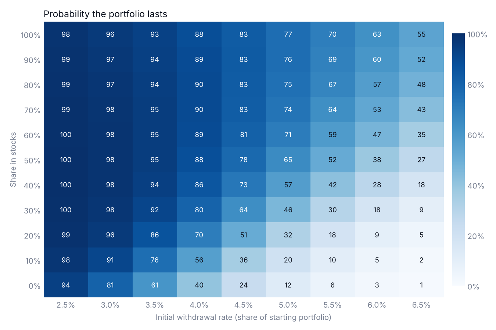
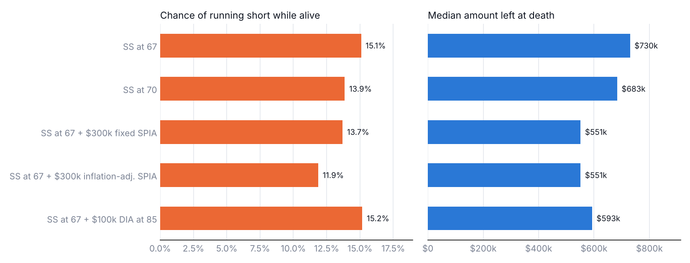

# Retirement Monte Carlo Simulator

**Will the money last?** A Monte Carlo simulator for retirement income: withdrawal rates, asset mix, sequence-of-returns risk, Social Security timing, annuities and longevity risk, with every probability reported alongside its confidence interval.

[](https://github.com/brushamo17/retirement-monte-carlo/actions/workflows/tests.yml)


### [Try the interactive demo →](https://brushamo17.github.io/retirement-monte-carlo/)

[](https://brushamo17.github.io/retirement-monte-carlo/)

**Key findings** (10,000 simulated retirements, illustrative assumptions)

- The classic 4% rule (60/40, 30 years) succeeds **89.6%** of the time (95% CI 89.0–90.2%).
- **Sequence risk dominates:** when the first decade's returns land in the worst fifth, only 56% of portfolios last, versus 100% in the best fifth. Bad returns in the last decade barely matter (87% vs 92%).
- An inflation-adjusted annuity cuts the chance of running short from 14.3% to 11.1% and raises the spending floor from 40% to 62% of the goal, at the cost of a smaller bequest.

The browser demo covers the core model; the Python package adds Social Security, pensions, annuities and random lifespans. The project applies the simulation methods from Georgia Tech's ISyE 3044 to the retirement-income questions at the core of financial planning.
---

## Quick start

```bash
git clone https://github.com/brushamo17/retirement-monte-carlo.git
cd retirement-monte-carlo
python -m venv .venv
source .venv/bin/activate          # Windows: .venv\Scripts\activate
pip install -r requirements.txt

python run_example.py              # prints every number below, saves the charts to figures/
pytest -q                          # 14 tests
```

Minimal use:

```python
from retirement_mc import RetirementPlan, SimulationConfig, simulate, social_security

plan = RetirementPlan(
    initial_portfolio=1_000_000,
    annual_spending=80_000,                          # total need, today's dollars
    stock_share=0.6,
    income=(social_security(32_000, claim_age=67, retirement_age=65),),
)
result = simulate(plan, SimulationConfig(n_paths=10_000, seed=3044))
print(result.success_probability())   # e.g. 85.7% (95% CI ...)
```

---

## Results

All figures come from `python run_example.py` (10,000 paths, seed 3044, lognormal returns, long-run US-style assumptions, 0.5% annual fees). The return assumptions are illustrative, not forecasts.

### 1. The 4% rule: $1M, $40k a year adjusted for inflation, 60/40, 30 years

| | Probability the money lasts |
|---|---|
| Plain Monte Carlo | **89.6%** (95% CI 89.0% to 90.2%) |
| Antithetic variates | 89.3% (SE 0.29% vs 0.31% plain) |
| Fat-tailed returns (Student-t, 5 df) | 87.9% |
| Guardrails spending rule | 99.6%, but the median retiree's lowest year is 90% of planned spending |

The browser version, written independently in JavaScript with a different random number generator, gets 89.3% for the same inputs. Two implementations agreeing within sampling error is a useful check that neither has a bug.


### 2. The policy map

Every cell uses the **same** 10,000 market paths (common random numbers), so the differences between cells come from the policy, not from sampling noise.



Two things stand out. Above about a 4% withdrawal rate, more stocks help, because the portfolio needs growth to keep up with withdrawals. At low withdrawal rates, the most aggressive mixes do slightly *worse* than balanced ones (97% at 100% stocks vs 100% at 60%), because volatility, not low returns, becomes the main threat.

### 3. Sequence-of-returns risk

The path with the median 30-year return (4.6% a year) replayed in three orders. Reordering doesn't change the average return at all, because multiplication commutes. It changes everything else:


| Paths grouped by return in... | Worst fifth | Best fifth |
|---|---|---|
| ...the first 10 years | 56% succeed | 100% succeed |
| ...the last 10 years | 87% succeed | 92% succeed |

Bad returns early in retirement hurt far more than bad returns late, because withdrawals lock in losses while the portfolio is at its largest.

### 4. Social Security and annuities, with a random lifespan

A 65-year-old with $1M who spends $80k a year and has a $32k Social Security benefit at full retirement age (67). Lifespans are drawn from a Gompertz mortality model (life expectancy 20.1 years; 53% reach 85, 15% reach 95), so success means *the money lasted as long as the retiree did*.

Annuity prices come from the same mortality model: a fixed immediate annuity (SPIA) pays 7.27% of the premium, an inflation-adjusted one 5.74%, and a deferred annuity starting at 85 (DIA) pays 68.3%.

| Scenario | Chance of running short | Median left at death | Spending floor if short |
|---|---|---|---|
| Social Security at 67 | 14.3% | $733k | 40% |
| Social Security at 70 | 12.9% | $680k | 50% |
| SS at 67 + $300k fixed SPIA | 11.8% | $566k | 54% |
| SS at 67 + $300k inflation-adjusted SPIA | 11.1% | $546k | 62% |
| SS at 67 + $100k DIA at 85 | 13.3% | $608k | 40% |

"Spending floor if short" is the median lowest spending, as a share of the $80k goal, among the paths that ran short.



The trade-off is the classic one. Guaranteed income lowers the chance of running short and, more importantly, raises the floor when things go wrong, from 40% of planned spending to 62% with an inflation-adjusted annuity. The cost is a smaller expected bequest. Delaying Social Security to 70 works like buying an inflation-protected annuity from the government: it lowers the shortfall risk and raises the floor (50% vs 40%) while giving up only $53k of median bequest, against $167k for the fixed SPIA. The cost is drawing more from the portfolio between 65 and 70.

---

## How the model works

### Returns

Each simulated year draws a real (after-inflation) stock return and bond return. Working in real terms means a "fixed" withdrawal is automatically inflation-adjusted.

**Lognormal mode.** Log-returns $X = \ln(1+R)$ are normal. To make simulated returns match a target arithmetic mean $m$ and standard deviation $s$, the lognormal parameters solve

$$\sigma^2 = \ln\!\left(1 + \frac{s^2}{(1+m)^2}\right), \qquad \mu = \ln(1+m) - \frac{\sigma^2}{2}.$$

**Correlation.** Independent standard normals $z$ become correlated shocks $\varepsilon = Lz$, where $L$ is the Cholesky factor of the correlation matrix. For two assets this is $\varepsilon_b = \rho z_s + \sqrt{1-\rho^2}\,z_2$.

**Fat tails.** In `model="t"` the correlated normals are divided by $\sqrt{\chi^2_\nu/(\nu-2)}$ using one chi-square draw per year shared across assets (a multivariate Student-t with $\nu = 5$). That keeps the variance the same but makes extreme years more common.

**Portfolio.** Rebalanced to its target mix every year: $r_p = w\,r_s + (1-w)\,r_b - \text{fee}$.

### Cash flows, one year at a time

For each path, at the start of year $t$:

1. Portfolio withdrawal $W_t = \max(\text{spending}_t - \text{income}_t,\ 0)$
2. If the balance $B_t < W_t$ while the retiree is alive, record a shortfall and withdraw what is left
3. $B_{t+1} = (B_t - W_t)(1 + r_{p,t})$

A path **succeeds** if it never records a shortfall while the retiree is alive.

**Guardrails** (simplified Guyton–Klinger). If the current withdrawal rate drifts 20% above its reference rate, spending is cut 10% (skipped in the final 15 years); if it drifts 20% below, spending rises 10%. The reference is the rate the original plan implies *for that year's income mix*, so the year Social Security starts doesn't look like a windfall.

### Guaranteed income

`IncomeStream` covers Social Security, pensions or anything else with an amount, a start year, an optional end year and an inflation flag. A nominal stream is converted to today's dollars by dividing by $(1+\pi)^t$, so a fixed pension loses about 40% of its real value over 20 years at 2.5% inflation.

**Social Security** uses current-law claiming adjustments for a full retirement age of 67: a reduction of 5/9 of 1% per month for the first 36 months before 67 and 5/12 of 1% beyond that (70% at 62), plus delayed retirement credits of 8% a year up to 70 (124%). Source: Social Security Administration.

**Annuities** are priced actuarially from the mortality model:

$$\ddot a_x = \sum_{t \ge d} \frac{{}_tp_x}{(1+i)^t}, \qquad \text{payout rate} = \frac{1 - \text{load}}{\ddot a_x}$$

where ${}_tp_x$ is the probability a person aged $x$ survives $t$ more years, $d$ is the deferral period (0 for a SPIA) and the load (5%) covers the insurer's costs and profit. A nominal discount rate prices a fixed annuity and a real rate prices an inflation-adjusted one, which is why the inflation-adjusted version pays less at the start.

### Longevity

The Gompertz law gives a closed-form survival curve

$$S(t \mid x) = \exp\!\left(e^{(x-m)/b}\,\bigl(1 - e^{t/b}\bigr)\right)$$

with modal age $m = 88$ and dispersion $b = 10$. Remaining lifetimes are sampled exactly by inverse transform: set $S(t) = U$ with $U \sim \text{Uniform}(0,1)$ and solve, which gives $t = b\ln\!\left(1 - \ln U \cdot e^{-(x-m)/b}\right)$.

### Estimating the probability

Each path is a Bernoulli trial, so

$$\hat p = \frac{\#\text{successes}}{N}, \qquad \text{SE} = \sqrt{\frac{\hat p(1-\hat p)}{N}}, \qquad \text{95\% CI} = \hat p \pm 1.96\,\text{SE}.$$

With 10,000 paths the SE is about 0.3 percentage points, so reporting "89.6%" to one decimal is honest and "89.63%" would not be.

**Antithetic variates.** Paths come in pairs driven by $z$ and $-z$. Because the two paths in a pair are dependent, the SE is computed from the $N/2$ pair averages. Here it only cuts the SE from 0.31% to 0.29%. That is expected: antithetics work best when the output is a monotone function of the inputs, and a yes/no success indicator is a coarse, threshold-shaped function of 30 years of returns.

**Common random numbers.** When comparing policies (the grid, the income scenarios), every policy runs on the same market paths and lifespans. The comparison then has far less variance than independent runs would, and under the fixed rule success is guaranteed to fall as the withdrawal rate rises, path by path. A test checks this.

---

## Code tour

```
retirement_mc/
  returns.py      capital market assumptions, lognormal / Student-t returns, Cholesky, antithetics
  mortality.py    Gompertz survival curve, inverse-transform lifetime sampling
  income.py       income streams, Social Security claiming factors, annuity pricing
  simulation.py   RetirementPlan, SimulationConfig, the year-by-year engine, results and SEs
  analysis.py     success grid (CRN), scenario comparison, sequence-risk quintiles, reorder demo
  plots.py        matplotlib charts
run_example.py    reproduces every number and chart in this README
tests/            14 pytest checks
docs/index.html   the browser version (served by GitHub Pages)
```

**Why loop over years but not over paths?** Each year depends on the previous year's balance, so time is sequential. Paths are independent of each other, so NumPy processes all 10,000 at once with array operations. The full example (about 110 simulations of 10,000 paths) runs in about 3 seconds.

**Tests** check the simulator against things that can be worked out by hand: with zero volatility the balance matches the closed-form annuity-due formula and fails in the predicted year; simulated returns reproduce the input mean, standard deviation and correlation; antithetic pairs are exact mirror images in log space; Gompertz samples match the analytic survival curve; Social Security factors match SSA's table; and the CRN grid is monotone.

---

## Limitations

- **Independent years.** Returns are i.i.d., so there is no mean reversion, momentum or regime switching. Historical block bootstrapping would capture some of that.
- **Constant inflation** for converting nominal income. In reality inflation is random and correlated with returns, which makes fixed annuities and pensions riskier than shown.
- **No taxes**, required minimum distributions, or account types (taxable, traditional, Roth).
- **Single life.** No spouse, survivor benefits or joint-life annuities.
- **Insurer credit risk** and annuity illiquidity are not modeled.
- **Illustrative inputs.** Return assumptions, the mortality table and the annuity discount rates should be replaced with sourced figures for real planning.

## What I'd add next


- Historical block bootstrap from annual US return data, compared against the parametric model
- Stochastic inflation correlated with bond returns
- Joint-life mortality for couples and survivor benefits
- Tax-aware withdrawal ordering across account types

---

## About

I'm Kai Okabe Henderson, a third-year Industrial and Systems Engineering student at Georgia Tech, concentrating in Economic and Financial Systems with a minor in International Business.

I built this project to work at the intersection of finance and simulation. It takes the Monte Carlo methods from ISyE 3044 (confidence intervals, variance reduction, common random numbers) and applies them to the questions financial planners work through with retirement clients:

- How much can I safely spend each year?
- How should the portfolio be invested?
- When should I claim Social Security?
- Is an annuity worth giving up part of my savings for?

Design priorities:

- **Every probability comes with a confidence interval.** A simulated success rate is an estimate, not a fact, and the interval shows how much to trust it.
- **Success rate isn't the only measure.** A yes/no success rate undervalues guarantees like annuities, which make bad outcomes less severe. So the results also report the spending floor when money runs short and the amount left at death.
- **Anyone can try it.** A browser version of the core model is hosted on GitHub Pages, so it runs without installing Python.

I developed this with Claude (Anthropic) as an AI coding assistant. Questions and feedback are welcome: kai606@gmail.com.
