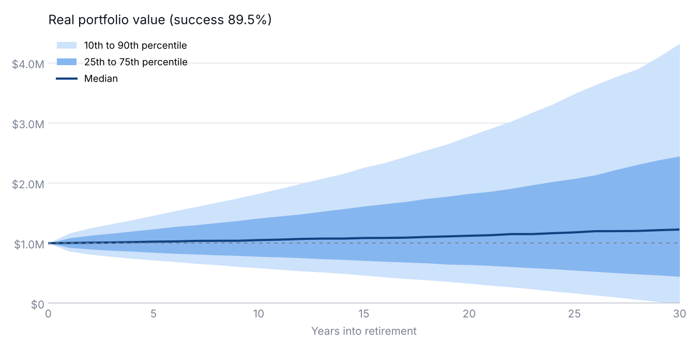
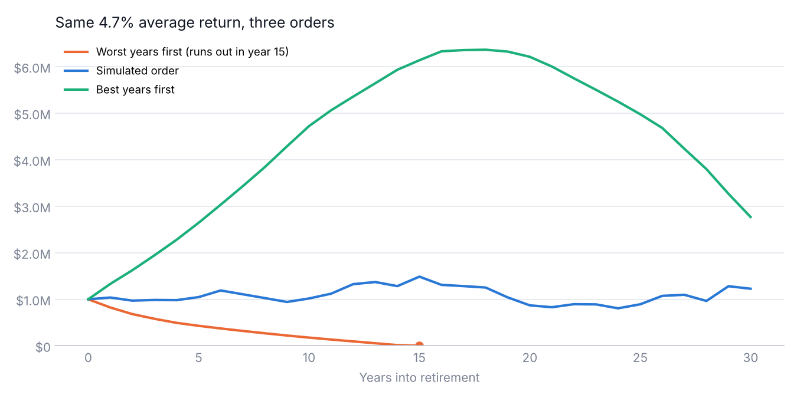
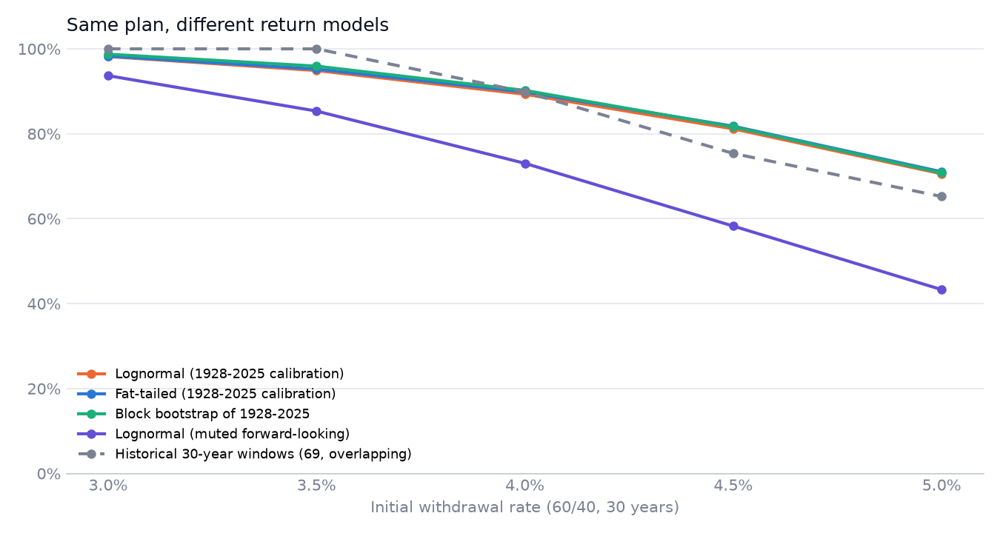

# Retirement Monte Carlo Simulator

**Will the money last?** A Monte Carlo simulator for retirement income: withdrawal rates, asset mix, sequence-of-returns risk, Social Security timing, annuities and longevity risk, with every probability reported alongside its confidence interval.

[](https://github.com/brushamo17/retirement-monte-carlo/actions/workflows/tests.yml)


### [Try the interactive demo →](https://brushamo17.github.io/retirement-monte-carlo/)

[](https://brushamo17.github.io/retirement-monte-carlo/)

**Key findings** (10,000+ simulated retirements; returns calibrated to US data for 1928–2025)

- The classic 4% rule (60/40, 30 years) succeeds **89.5%** of the time (95% CI 88.8–90.1%). Three different return models fitted to history agree within a point, and the rule survived 62 of the 69 actual 30-year retirements since 1928. Every failure started between 1962 and 1969.
- **The assumptions matter more than the model.** Lower forward-looking return assumptions cut that 89.5% to 73%. That gap is more than 50 times the Monte Carlo standard error.
- **Sequence risk dominates:** when the first decade's returns land in the worst fifth, only 56% of portfolios last, versus 100% in the best fifth. Bad returns in the last decade barely matter (87% vs 92%).
- **Guardrails have a hidden cost.** Flexible spending almost never runs out of money (99.7%), but 1 in 4 retirees see spending fall below 80% of the plan along the way.
- An inflation-adjusted annuity cuts the chance of running short from 15.0% to 11.8% and raises the spending floor from 40% to 62% of the goal, at the cost of a smaller bequest.

The browser demo covers the core model; the Python package adds Social Security, pensions, annuities, random lifespans and the historical bootstrap. The project applies the simulation methods from Georgia Tech's ISyE 3044 to the retirement-income questions at the core of financial planning.

---

## Quick start

```bash
git clone https://github.com/brushamo17/retirement-monte-carlo.git
cd retirement-monte-carlo
python -m venv .venv
source .venv/bin/activate          # Windows: .venv\Scripts\activate
pip install -r requirements.txt

python run_example.py              # prints the results below, saves the charts to figures/
python research.py                 # robustness experiments (about a minute)
pytest -q                          # 33 tests
```

Minimal use:

```python
from retirement_mc import RetirementPlan, SimulationConfig, simulate, social_security

plan = RetirementPlan(
    initial_portfolio=1_000_000,
    annual_spending=80_000,                          # total need, today's dollars
    stock_share=0.6,
    income=(social_security(32_000, claim_age=67, retirement_age=65),),
)
result = simulate(plan, SimulationConfig(n_paths=10_000, seed=3044))
print(result.success_probability())   # 67.7% (95% CI 66.8% to 68.6%, ...)
```

---

## Market assumptions

Returns are calibrated to annual US data for 1928–2025: S&P 500 and 10-year Treasury total returns from Aswath Damodaran (NYU Stern), deflated by December-to-December CPI from the Bureau of Labor Statistics. The data ships with the package (`retirement_mc/data/`); `SOURCES.md` documents it and the checks run on it.

| Real annual return, 1928–2025 | Stocks | Bonds |
|---|---|---|
| Arithmetic mean | 8.6% | 1.8% |
| Standard deviation | 19.3% | 8.9% |
| Correlation | 0.09 | |
| Inflation (compound) | 3.0% | |

For a forward-looking stress test, `MUTED_FORWARD` uses lower round-number assumptions (stocks 5.5%, bonds 1.5%), in the spirit of the lower expected returns many firms have published recently. Those numbers are illustrative and don't come from any single firm's forecast.

---

## Results

All figures come from `python run_example.py` (10,000 paths, seed 3044, lognormal returns calibrated to 1928–2025, 0.5% annual fees).

### 1. The 4% rule: $1M, $40k a year adjusted for inflation, 60/40, 30 years

| | Probability of success |
|---|---|
| Plain Monte Carlo | **89.5%** (95% CI 88.8% to 90.1%) |
| Antithetic variates | 89.4% (SE 0.29% vs 0.31% plain) |
| Fat-tailed returns (two-regime mixture) | 89.6% |
| Historical block bootstrap | 90.0% |
| Guardrails spending rule | 75.3%: never ran out in 99.6% of paths, but spending fell below 80% of the plan in 24.7% |

The browser version, written separately in JavaScript with a different random number generator, gets 89.0% for the same inputs. That's within sampling error of 89.5%, a useful check that neither implementation has a bug.



### 2. The policy map

Every cell uses the **same** 10,000 market paths (common random numbers), so the differences between cells come from the policy, not from sampling noise.


Above about a 4% withdrawal rate, more stocks help, because the portfolio needs growth to keep up with withdrawals. At low withdrawal rates, the most aggressive mixes do slightly *worse* than balanced ones (98% at 100% stocks vs 100% at 60%), because volatility, not low returns, becomes the main threat. All-bond portfolios do poorly everywhere: since 1928, 10-year Treasuries have returned only 1.8% a year after inflation, with 8.9% volatility.

### 3. Sequence-of-returns risk

The path with the median 30-year return (4.7% a year) replayed in three orders. Reordering doesn't change the average return at all, because multiplication commutes. It changes everything else:



| Paths grouped by return in... | Worst fifth | Best fifth |
|---|---|---|
| ...the first 10 years | 56% succeed | 100% succeed |
| ...the last 10 years | 87% succeed | 92% succeed |

Bad returns early in retirement hurt far more than bad returns late, because withdrawals lock in losses while the portfolio is at its largest.

### 4. Social Security and annuities, with a random lifespan

A 65-year-old with $1M who spends $80k a year and has a $32k Social Security benefit at full retirement age (67). Lifespans are drawn from a Gompertz mortality model (life expectancy 20.1 years; 53% reach 85, 15% reach 95), so success means *the money lasted as long as the retiree did*.

Annuity prices come from the same mortality model: a fixed immediate annuity (SPIA) pays 7.27% of the premium, an inflation-adjusted one 5.74%, and a deferred annuity starting at 85 (DIA) pays 68.3%.

| Scenario | Chance of running short | Median left at death | Spending floor if short |
|---|---|---|---|
| Social Security at 67 | 15.0% | $736k | 40% |
| Social Security at 70 | 13.8% | $690k | 50% |
| SS at 67 + $300k fixed SPIA | 13.6% | $555k | 52% |
| SS at 67 + $300k inflation-adjusted SPIA | 11.8% | $554k | 62% |
| SS at 67 + $100k DIA at 85 | 15.1% | $597k | 40% |

"Spending floor if short" is the median lowest spending, as a share of the $80k goal, among the paths that ran short.


Guaranteed income lowers the chance of running short and, more importantly, raises the floor when things go wrong: from 40% of planned spending to 62% with an inflation-adjusted annuity. The cost is a smaller expected bequest. Three results are worth noticing:

- **Delaying Social Security to 70** works like buying an inflation-protected annuity from the government. It lowers shortfall risk and raises the floor for $46k of median bequest, against about $180k for either commercial annuity.
- **The fixed annuity barely beats delaying Social Security.** At 3% inflation, a fixed payment loses 45% of its purchasing power over 20 years, just as the retiree is most likely to need it.
- **The deferred annuity doesn't move the shortfall odds** (15.1% vs 15.0%). After 85 it covers most of the gap, so late shortfalls become small cuts instead of collapses. But those still count as "running short", and the $100k premium makes earlier shortfalls slightly more likely. A yes/no success rate undervalues this kind of insurance.

---

## Robustness: how much do the answers depend on the model?

`python research.py` reruns the core questions with 50,000 paths each. Full output: [`research_results.txt`](research_results.txt).

### Model risk



| Success of a 60/40, 30-year plan | 3.0% | 3.5% | 4.0% | 4.5% | 5.0% |
|---|---|---|---|---|---|
| Lognormal, calibrated to 1928–2025 | 98.2% | 94.9% | 89.3% | 81.2% | 70.6% |
| Fat-tailed, calibrated to 1928–2025 | 98.3% | 95.2% | 89.8% | 81.8% | 71.0% |
| Block bootstrap of 1928–2025 | 98.7% | 95.9% | 90.2% | 81.6% | 70.8% |
| Lognormal, muted forward-looking | 93.7% | 85.3% | 73.0% | 58.3% | 43.3% |
| Actual 30-year windows since 1928 (69) | 100% | 100% | 89.9% | 75.4% | 65.2% |

The three models fitted to history agree within about one point at every withdrawal rate. The shape of the return distribution matters little once its mean and volatility are pinned down. The expected-return assumption is what moves the answer: the muted assumptions cut success at 4% by 16 points. Sampling error, at 0.1–0.3 points, is the smallest source of uncertainty by far. That's model risk, and it's the main reason a planner should present a range rather than one number.

The historical windows overlap heavily (the 1966 and 1967 retirements share 29 years), so they are a sanity check rather than 69 independent data points. Every 4% failure started between **1962 and 1969**: retirees who met the 1970s stagflation in their first decade.

### Convergence

| Paths | Success | Standard error |
|---|---|---|
| 1,000 | 90.4% | 0.93 pp |
| 10,000 | 89.5% | 0.31 pp |
| 100,000 | 89.1% | 0.10 pp |

The SE shrinks with $1/\sqrt{N}$: 100 times the paths gives one-tenth of the error, an 89% reduction here against 90% in theory.

### What guardrails cost

| 4% start, 60/40, 30 years | Never ran out | Success (with 80% floor) | Any spending cut | Spending below 80% of plan | Median lowest spending |
|---|---|---|---|---|---|
| Fixed, 1928–2025 calibration | 89.3% | 89.3% | 0% | 10.5% | $40,000 |
| Guardrails, 1928–2025 calibration | 99.7% | 75.4% | 54.5% | 24.6% | $36,000 |
| Fixed, muted forward | 73.0% | 73.0% | 0% | 26.4% | $40,000 |
| Guardrails, muted forward | 99.1% | 58.5% | 71.6% | 41.5% | $32,400 |

Guardrails almost never run out because they turn a portfolio failure into a series of spending cuts. Whether that's a better outcome depends on how far the retiree can cut. Counting a drop below 80% of the plan as a failure, guardrails succeed *less* often than fixed spending.

### Annuity trade-off, measured as a paired difference

Both plans run on the same 50,000 market paths and lifespans, so the improvement can be estimated path by path:

| | Success | Median left at death | Floor if short |
|---|---|---|---|
| No annuity | 85.0% | $753k | 40% |
| $300k inflation-adjusted SPIA | 88.2% | $564k | 62% |

The annuity improves success by **3.26 points (95% CI 3.11 to 3.42)**. The standard error of that difference is 0.08 points, against 0.22 if the two plans had been simulated independently. Common random numbers bought the same precision with about one-seventh of the paths.

---

## How the model works

### Returns

Each simulated year draws a real (after-inflation) stock return and bond return. Working in real terms means a "fixed" withdrawal is automatically inflation-adjusted. Three models are available:

**Lognormal** (`model="lognormal"`, the default). Log-returns $X = \ln(1+R)$ are normal. To match a target arithmetic mean $m$ and standard deviation $s$:

$$\sigma^2 = \ln\!\left(1 + \frac{s^2}{(1+m)^2}\right), \qquad \mu = \ln(1+m) - \frac{\sigma^2}{2}.$$

**Correlation.** Independent standard normals $z$ become correlated shocks $\varepsilon = Lz$, where $L$ is the Cholesky factor of the log-space correlation matrix; for two assets, $\varepsilon_b = \rho z_s + \sqrt{1-\rho^2}\,z_2$. Correlation quoted in capital market assumptions describes *arithmetic* returns, which differs slightly from log-space correlation. So the log-space $\rho$ is solved numerically from

$$\text{Corr}(e^X, e^Y) = \frac{e^{\rho\sigma_x\sigma_y} - 1}{\sqrt{(e^{\sigma_x^2}-1)(e^{\sigma_y^2}-1)}}$$

to hit the target exactly.

**Fat-tailed** (`model="fat_tailed"`). A two-regime scale mixture: in 90% of years log-returns have volatility $\sigma$, and in 10% they have $2\sigma$, for stocks and bonds together. The mean, volatility and correlation are matched exactly (by bisection), so only the tails change: kurtosis of log stock returns rises to about 4.5, against 3.55 in the 1928–2025 data and 3 for a normal distribution. A Student-t is an infinite scale mixture of normals, but $E[e^X]$ is infinite for a Student-t, so lognormal-style calibration is impossible and arithmetic t returns need an artificial floor at −100%. The two-regime mixture avoids both problems.

**Historical block bootstrap** (`model="bootstrap"`). Each path is stitched together from random 5-year runs of actual 1928–2025 real returns, wrapping around the end of the sample (a circular block bootstrap). Stocks and bonds always come from the same calendar year. No distribution is assumed, and multi-year patterns like the 1970s survive within blocks.

**Portfolio.** Rebalanced to its target mix every year: $r_p = w\,r_s + (1-w)\,r_b - \text{fee}$.

### Cash flows, one year at a time

For each path, at the start of year $t$:

1. Portfolio withdrawal $W_t = \max(\text{spending}_t - \text{income}_t,\ 0)$
2. If the balance $B_t < W_t$ while the retiree is alive, record a shortfall and withdraw what is left
3. $B_{t+1} = (B_t - W_t)(1 + r_{p,t})$

A path **succeeds** if, in every year the retiree is alive, (a) that year's spending target is fully funded and (b) actual spending stays at or above a floor, 80% of the original goal by default (`spending_floor`). Under fixed spending, (b) adds nothing, because spending only drops when the money runs out. Under guardrails it matters: without it, a retiree whose spending was cut to 60% of the plan would still count as a success.

**Guardrails** (simplified Guyton–Klinger). If the current withdrawal rate drifts 20% above its reference rate, spending is cut 10% (skipped in the final 15 years); if it drifts 20% below, spending rises 10%. The reference is the rate the original plan implies *for that year's income mix*, so the year Social Security starts doesn't look like a windfall.

### Guaranteed income

`IncomeStream` covers Social Security, pensions or anything else with an amount, a start year, an optional end year and an inflation flag. A nominal stream is converted to today's dollars by dividing by $(1+\pi)^t$ at the historical inflation rate of 3.0%, so a fixed pension loses about 45% of its real value over 20 years.

**Social Security** uses current-law claiming adjustments for a full retirement age of 67: a reduction of 5/9 of 1% per month for the first 36 months before 67 and 5/12 of 1% beyond that (70% at 62), plus delayed retirement credits of 8% a year up to 70 (124%). Source: Social Security Administration.

**Annuities** are priced actuarially from the mortality model:

$$\ddot a_x = \sum_{t \ge d} \frac{{}_tp_x}{(1+i)^t}, \qquad \text{payout rate} = \frac{1 - \text{load}}{\ddot a_x}$$

where ${}_tp_x$ is the probability a person aged $x$ survives $t$ more years, $d$ is the deferral period (0 for a SPIA) and the load (5%) covers the insurer's costs and profit. A nominal discount rate prices a fixed annuity and a real rate prices an inflation-adjusted one, which is why the inflation-adjusted version pays less at the start.

### Longevity

The Gompertz law gives a closed-form survival curve

$$S(t \mid x) = \exp\!\left(e^{(x-m)/b}\,\bigl(1 - e^{t/b}\bigr)\right)$$

with modal age $m = 88$ and dispersion $b = 10$. Remaining lifetimes are sampled exactly by inverse transform: set $S(t) = U$ with $U \sim \text{Uniform}(0,1)$ and solve, which gives $t = b\ln\!\left(1 - \ln U \cdot e^{-(x-m)/b}\right)$. The simulation runs to age 115, which fewer than one retiree in a million outlives under these parameters. If a plan's settings let more than 0.1% of retirees outlive the horizon, the simulator warns rather than silently treating them as successes.

### Estimating probabilities

Each path is a Bernoulli trial, so

$$\hat p = \frac{\#\text{successes}}{N}, \qquad \text{SE} = \sqrt{\frac{\hat p(1-\hat p)}{N}}, \qquad \text{95\% CI} = \hat p \pm 1.96\,\text{SE}.$$

With 10,000 paths the SE is about 0.3 percentage points, so reporting "89.5%" to one decimal is honest and "89.53%" would not be.

**Antithetic variates.** Paths come in pairs driven by $z$ and $-z$. Because the two paths in a pair are dependent, the SE is computed from the $N/2$ pair averages. Here it only cuts the SE from 0.31% to 0.29%. That's expected: antithetics work best when the output is a monotone function of the inputs, and a yes/no success indicator is a coarse, threshold-shaped function of 30 years of returns.

**Common random numbers.** When comparing plans (the grid, the income scenarios, the annuity test), every plan runs on the same market paths and the same longevity draws. Longevity is shared as the underlying *uniform* draws, so plans with different mortality assumptions or retirement ages still face matched luck: each converts the same $U$ into a lifespan through its own survival curve. The difference between two plans is then estimated path by path, with variance $\text{Var}(A) + \text{Var}(B) - 2\,\text{Cov}(A,B)$, and CRN makes the covariance large.

---

## Code tour

```
retirement_mc/
  history.py      1928-2025 US returns and inflation (data/ holds the CSV and its sources)
  returns.py      calibration, lognormal / fat-tailed / bootstrap returns, Cholesky, antithetics
  mortality.py    Gompertz survival curve, inverse-transform lifetime sampling
  income.py       income streams, Social Security claiming factors, annuity pricing
  simulation.py   RetirementPlan, SimulationConfig, the year-by-year engine, success, SEs
  analysis.py     success grid and scenario comparisons (CRN), paired differences,
                  sequence-risk quintiles, reorder demo, historical backtest
  plots.py        matplotlib charts
run_example.py    reproduces the Results section
research.py       reproduces the Robustness section
tests/            33 pytest checks
docs/index.html   the browser version (served by GitHub Pages)
```

**Why loop over years but not over paths?** Each year depends on the previous year's balance, so time is sequential. Paths are independent of each other, so NumPy processes all of them at once with array operations. The full example runs in about 3 seconds.

**Tests** check the simulator against things that can be worked out by hand or looked up:
- With zero volatility, the balance matches the closed-form annuity-due formula and fails in the predicted year.
- Both parametric models reproduce the input mean, volatility *and* arithmetic correlation. The numeric calibration matches the closed-form lognormal formulas.
- The bundled data compounds to the published long-run returns (9.94% for stocks and 4.50% for bonds, 1928–2024).
- Bootstrap paths consist of genuine consecutive historical years.
- Antithetic pairs are exact mirror images, and Gompertz samples match the analytic survival curve.
- Social Security factors match SSA's table.
- Guardrail cuts below the floor count as failures.
- Comparisons respect each plan's own mortality, and the CRN grid is monotone.

---

## Limitations

- **One country's history.** The calibration and bootstrap use US data, from one of the best-performing markets of the last century. International data would give more sobering results.
- **Independence across years.** The parametric models treat years as independent; the bootstrap keeps multi-year structure only within 5-year blocks.
- **Constant inflation** for converting nominal income. In reality inflation is random and correlated with returns, which makes fixed annuities and pensions riskier than shown.
- **Illustrative mortality and annuity pricing.** The Gompertz parameters aren't fitted to a published life table, and annuity rates come from assumed discount rates, not insurer quotes.
- **No taxes**, required minimum distributions, or account types (taxable, traditional, Roth).
- **Single life.** No spouse, survivor benefits or joint-life annuities.
- **Insurer credit risk** and annuity illiquidity are not modeled.

## What I'd add next

- Fit the mortality model to the SSA period life table
- Stochastic inflation correlated with bond returns, drawn from the same historical data
- Joint-life mortality for couples and survivor benefits
- Tax-aware withdrawal ordering across account types

---

## About

I'm Kai Okabe Henderson, a third-year Industrial and Systems Engineering student at Georgia Tech, concentrating in Economic and Financial Systems with a minor in International Business.

I built this project to work at the intersection of finance and simulation. It takes the Monte Carlo methods from ISyE 3044 (confidence intervals, variance reduction, common random numbers) and applies them to the questions financial planners work through with retirement clients:

- How much can I safely spend each year?
- How should the portfolio be invested?
- When should I claim Social Security?
- Is an annuity worth giving up part of my savings for?

Design priorities:

- **Every probability comes with a confidence interval.** A simulated success rate is an estimate, not a fact, and the interval shows how much to trust it.
- **Success rate isn't the only measure.** A yes/no success rate undervalues guarantees like annuities, which make bad outcomes less severe. So the results also report the spending floor when money runs short and the amount left at death.
- **Anyone can try it.** A browser version of the core model is hosted on GitHub Pages, so it runs without installing Python.

I developed this with Claude (Anthropic) as an AI coding assistant. Questions and feedback are welcome: kai606@gmail.com.
